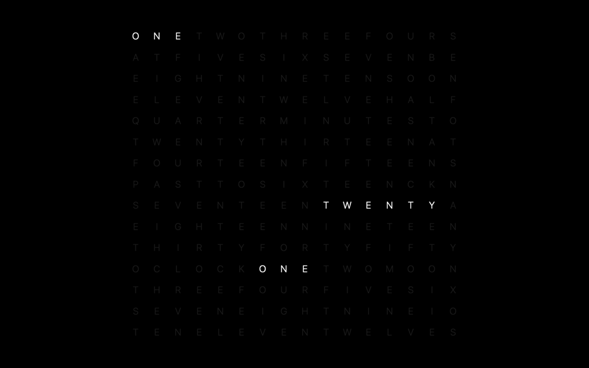

# Grid Clock

A word clock screensaver for macOS, originally created by
[Christopher Newton](https://github.com/chrstphrknwtn/grid-clock-screensaver)
and ported to modern macOS. The face is a 16 × 15 grid of letters; the lit
ones read out the time.



## Requirements

macOS 14 or later, Apple silicon.

## Install

Download the `grid-clock_<version>_arm64.zip` asset of the
[latest release](https://github.com/forkcloser/grid-clock-screensaver/releases/latest),
unzip it and double-click `Grid Clock.saver`. The release is signed and
notarized; macOS installs it into `~/Library/Screen Savers`.

Or from a terminal:

```sh
curl --proto '=https' --tlsv1.2 -fsSL https://github.com/forkcloser/grid-clock-screensaver/releases/latest/download/install.sh | bash
```

The installer verifies the release with [cosign](https://github.com/sigstore/cosign)
(`brew install cosign`) and installs into `~/Library/Screen Savers`;
`--system` installs for all users, `--version X.Y.Z` pins a release, `--help`
lists the rest. Verifying the assets yourself:
[DEVELOPMENT.md](./DEVELOPMENT.md#installer-verification).

From source, with Xcode installed:

```sh
git clone https://github.com/forkcloser/grid-clock-screensaver.git
cd grid-clock-screensaver
just install
```

### Select it

Quit System Settings first (⌘Q; it reads the screensaver list once at
launch).

- **macOS 26:** System Settings → **Wallpaper** → **Screen Saver…** (top
  right). Grid Clock is in the last section, next to **Message**.
- **macOS 14 and 15:** System Settings → **Screen Saver**, at the bottom of
  the list under *Other*.

## Options

**Options…** below the preview:

| Setting | Effect |
| --- | --- |
| Main display only *(default)* | Clock on the main display, other displays black |
| All displays | Clock on every display |
| Brightness *(default 100 %)* | Dims lit and unlit letters together, 5–100 % |

A display arranged *above or below* the main one may stay dark: the macOS
screensaver host places its window off-screen, and no saver can correct it.
Arrange displays side by side as the workaround.

## Uninstall

```sh
just uninstall            # or: rm -rf ~/Library/'Screen Savers'/'Grid Clock.saver'
```

Preferences are left behind; to clear them:

```sh
defaults -currentHost delete org.forkcloser.grid-clock
rm -f ~/Library/Preferences/ByHost/org.forkcloser.grid-clock.*.plist
# and, from 1.0.0 or earlier:
defaults -currentHost delete world.farcloser.grid-clock
rm -f ~/Library/Preferences/ByHost/world.farcloser.grid-clock.*.plist
```

## About this fork

A fork of [chrstphrknwtn/grid-clock-screensaver](https://github.com/chrstphrknwtn/grid-clock-screensaver),
whose `WebView` rendering stopped working on macOS 14. This port draws the
clock natively with Core Text; the bundle loads nothing at runtime. The clock
is the same one, checked against the original for every minute of the day.
What the fork adds and changes for a user is the table in
[`UPSTREAM.md`](./UPSTREAM.md); build, tests and releases are in
[DEVELOPMENT.md](./DEVELOPMENT.md).

## Reporting

The issue tracker is off. Security reports go through
[private vulnerability reporting](https://github.com/forkcloser/grid-clock-screensaver/security/advisories/new).

## Licensing

[MIT](./LICENSE).

Upstream has no `LICENSE` file. On 2026-09-19, its author granted this fork,
in [chrstphrknwtn/grid-clock-screensaver#13](https://github.com/chrstphrknwtn/grid-clock-screensaver/issues/13):

> I hereby grant you a licence to reproduce and distribute the original code,
> without limitation.
>
> I will leave this repo as a historical artefact, and let your fork be a
> distinct modern version.

The clock's design (letter grid, vocabulary, palette, crossfade, minute rules)
is Christopher Newton's.

## Related

- [Epoch Flip Clock Screensaver](https://github.com/chrstphrknwtn/epoch-flip-clock-screensaver)
- [Word Clock Screensaver](https://github.com/chrstphrknwtn/word-clock-screensaver)
